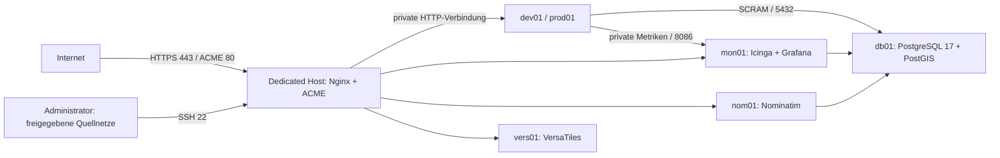

# Hetzner Dedicated: Debian 13

Dieser Pfad unterstützt Debian 13 `trixie` auf einem amd64-Dedicated-Host und
in `db01`, `dev01`, `prod01`, `mon01`, `nom01` und `vers01`. QEMU/KVM, libvirt,
`virt-install` und Cloud-init ersetzen hier uvtool. Die Ubuntu-Konfiguration
bleibt separat und unverändert.

**Auf `94.130.236.38` wurde nichts ausgerollt. Ein Deployment darf erst nach
ausdrücklicher Freigabe des Betreibers erfolgen.** Auch `--check` ist keine
rein lesende Serverbestandsaufnahme: Ansible kann dabei temporäre Dateien
anlegen. Entwicklungsprüfungen verwenden ausschließlich lokale Fixtures/CI.

## Bestandsaufnahme und belegter Stand

Ausgangsstand: `main` / `5da0e94acf8ee10b1a8cb112cd591ddb6b7f0ff6`.

| Bereich | Vorhandener Ubuntu-Pfad | Neuer Debian-Pfad |
| --- | --- | --- |
| Einstieg | `ansible.cfg`, `playbooks/site.yml` | `ansible-debian13.cfg`, `playbooks/debian13/site.yml` |
| VM-Erstellung | Ubuntu Noble, uvtool/Simplestreams | Debian Genericcloud, QEMU-Vollkopien, virt-install, NoCloud-ISO |
| Storage | `/var/lib/libvirt/images` | `/data/libvirt/images` mit verpflichtender UUID-Prüfung |
| Netzwerk | libvirt `default`, DHCP und Runtime-Inventory | eigenes `uranus-debian13`, feste DHCP-Reservierungen |
| Zertifikate | lokale Testzertifikate/VM-Certbot | öffentlich vertrauenswürdige ACME-Zertifikate ausschließlich am Host |
| Datenbank | Legacy-Rolle kann Datenbanken bei Schema-/Markeränderungen löschen | separate Rolle ohne Datenbanklöschung oder automatische Wiederimporte |
| Nominatim | Legacy-Rolle kann bei fehlendem Marker neu importieren | tatsächlichen DB-Zustand prüfen, vorhandene Daten immer erhalten |
| Monitoring | Ubuntu-PHP 8.3 und Lab-Konfiguration | Debian-PHP 8.4, private Listener, geschützte Initialisierung |

Die lokalen, uncommitteten Dateien `vars.yml` und
`inventory/hetzner.ini` wurden nicht geändert und nicht in den PR aufgenommen. Die Umsetzung
erfolgte in einem separaten Feature-Worktree.

Die ausschließlich lesende SSH-Bestandsaufnahme wurde am 10.10.2026 mit dem
bestätigten Zugang `awendelk@94.130.236.38` versucht. Der vorhandene RSA-Agent
verweigerte die Signatur; die vorhandenen Ed25519- und direkten RSA-Schlüssel
wurden vom Server abgelehnt. Es wurden keine Schlüssel installiert, keine
Zugänge verändert und keine Remote-Kommandos ausgeführt. Debian-Version,
Hardware, freie Kapazität, `/data`, Dienste, vorhandene VMs und Firewallzustand
des Servers sind deshalb **noch nicht verifiziert**. Vor einer Freigabe muss
diese Bestandsaufnahme über den bereits autorisierten Zugang nachgeholt werden.

Zulässige lesende Prüfungen dafür sind beispielsweise `cat /etc/os-release`,
`lscpu`, `free -m`, `lsblk`, `findmnt -M /data`, `df -hT /data`, `ip address`,
`ip route`, `ss -lnt`, `dpkg-query`, `systemctl is-active` sowie libvirt-
Listen/XML-Abfragen. Ansible-Provisioning, Paketinstallation, Dienststarts,
Firewalländerungen und VM-/Datenbanktests sind auf dem Server bis zur Freigabe
ausgeschlossen.

## Architektur und Ressourcen



Alle Gäste befinden sich im privaten IPv4-Netz `10.77.0.0/24` hinter NAT;
`virbr-uranus` / `10.77.0.1` ist das Gateway. Es werden keine öffentlichen
Gast-IP-Adressen, physischen Bridges oder eingehenden Portweiterleitungen
angelegt. IPv6-DHCP und Router Advertisements sind in den Gästen deaktiviert.
Der Host-Proxy kann HTTP/HTTPS auch über IPv6 annehmen, aber die initiale
DNS-Prüfung verlangt ausschließlich A-Records auf die bestätigte IPv4-Adresse.
AAAA-Records sind vor einem gesondert geprüften IPv6-Konzept nicht zulässig.

| VM | Private IP | RAM (MiB) | vCPU | Disk (GiB) | Aufgabe |
| --- | --- | ---: | ---: | ---: | --- |
| db01 | 10.77.0.11 | 12288 | 4 | 150 | PostgreSQL 17, PostGIS, App-/Monitoring-/Nominatim-Datenbanken |
| dev01 | 10.77.0.12 | 4096 | 2 | 60 | Entwicklungs-Backend und statisches Frontend |
| prod01 | 10.77.0.13 | 8192 | 4 | 100 | Produktives Backend und Frontend |
| mon01 | 10.77.0.14 | 4096 | 2 | 50 | Icinga2 → InfluxDB → Grafana, Icinga Web |
| nom01 | 10.77.0.15 | 12288 | 6 | 200 | Nominatim API und initialer Schleswig-Holstein-Import |
| vers01 | 10.77.0.16 | 2048 | 2 | 40 | VersaTiles und regionaler Kartenausschnitt |

Die VMs benötigen zusammen 42 GiB RAM und 600 GiB virtuelle Plattenkapazität.
Der Host benötigt zusätzlich mindestens 4 GiB RAM-Reserve. Neue Platten werden
konservativ gegen freie Kapazität einschließlich 5 GiB Storage-Reserve geprüft;
Sparse-Dateien werden nicht als Erlaubnis zur Überbelegung betrachtet.
Die Quellwerte stehen in `environments/hetzner/group_vars/all.yml`.
Adressen, Firewall- und DB-ACLs bilden ein zusammenhängendes festes Layout;
Netzwerkänderungen müssen gemeinsam in Inventory, VM-Liste und ACLs geprüft
werden. Bestehende Ressourcen werden dabei nicht automatisch umgebaut.

## Storage und wiederholte Läufe

Vor Paket-/Provisionierungsänderungen prüft `uranus_storage_guard`:

- `/data` ist ein eigener, beschreibbarer Mountpunkt.
- Die UUID lautet genau `7f882d89-a2cf-46d2-9db8-5333be51a300`.
- Images, Image-Cache und Cloud-init liegen auf diesem Dateisystem.
- Symlinks und zusätzliche Mounts unter diesen Storage-Pfaden werden abgelehnt.

Das Playbook mountet, formatiert oder repariert `/data` niemals. Ein fehlender
Mount führt zum Abbruch, bevor Images auf dem Root-Dateisystem entstehen.
Die Prüfung wiederholt sich im Provisionierungsmodul vor den einzelnen
Storage-/libvirt-Änderungen. Systemd-Abhängigkeiten und ein UUID-Startschutz für
`libvirtd`, `virtqemud` und `libvirt-guests` verhindern auch beim Neustart einen
VM-Start auf einem fehlenden oder falschen Datenträger. QEMU muss bereits
Traversal-Zugriff auf `/data/libvirt/images` besitzen; die Rechte des
übergeordneten Daten-Mounts werden nicht automatisch angepasst.

Ein offizielles Debian-13-Genericcloud-Image ist mit Build `20261001-2618` und
SHA512 fest referenziert. Neue VMs erhalten eigenständige qcow2-Vollkopien ohne
Backing-File. Eine spätere Änderung des Basisimages verändert bestehende
Gastplatten nicht. VM-Platten liegen als `/data/libvirt/images/<name>.qcow2`,
NoCloud-Seeds unter `/data/libvirt/cloud-init/<name>/`.

Das Provisionierungsmodul prüft zunächst alle ausgewählten VMs, Netzwerk und
Pool. Fehlerhafte libvirt-Abfragen werden nicht als „nicht vorhanden“ behandelt.
Vorhandene Domains benötigen die Kennzeichnung `uranus-debian13/v1`, erwarteten
Plattenpfad, MAC, Netzwerk, CPU, RAM und Plattengröße. Unbekannte Domains,
Konfigurationsabweichungen, Netz-/Routenkollisionen und verwaiste Platten/Seeds
führen zum Abbruch. Die Domain wird weder ersetzt noch verkleinert. Vorhandene,
gestoppte VMs bleiben standardmäßig gestoppt; ihr bewusster Start benötigt
`hetzner_start_existing_vms: true`.

Ein exklusives lokales Host-Lock verhindert parallele VM-Erstellung durch
mehrere Ansible-Controller. Neu erzeugte Disks werden ohne Überschreiben eines
zwischenzeitlich entstandenen Zielpfads veröffentlicht. Ein Teilfehler lässt
die entstandenen Daten für die manuelle Wiederherstellung stehen. Es gibt keine
automatische „Bereinigung“ von VM-Storage. `recreate_existing_vms=true` wird im
Debian-Pfad ausdrücklich abgelehnt.

## Netzwerk, TLS und Zugriffsschutz

Der Host verwendet eine eigene nftables-Tabelle. Sie öffnet SSH nur für die
ausdrücklich angegebenen Management-CIDRs sowie HTTP/HTTPS für den Proxy.
DHCP/DNS für Gäste und notwendiges ICMP bleiben möglich. Andere Host-Ports
werden gesperrt. Die Tabelle wird atomar ersetzt, ohne libvirts NAT-Tabellen
oder andere Firewalltabellen zu löschen. Bestehende Regeln anderer Systeme
können weiterhin Zugriffe sperren und müssen vor Deployment lesend geprüft
werden. Die Standard-`nftables.service` des Hosts wird nicht umkonfiguriert.

Die separaten Gast-Firewalls erlauben SSH und Webzugriff nur vom NAT-Gateway.
PostgreSQL erhält individuelle Regeln für Dev, Prod, Monitoring und Nominatim;
die `pg_hba.conf` beschränkt zusätzlich Benutzer und Datenbanken mit SCRAM.
InfluxDB ist nur für die beiden App-VMs sowie den lokalen Monitoring-Stack
zugänglich. Grafana, Backend und VersaTiles werden durch die Gast-Firewall
geschützt; Grafana und VersaTiles lauschen auf Loopback. Der Icinga-API-Port
wird nicht freigegeben. Gast-Firewalls werden ausschließlich auf diesen neu
verwalteten Debian-Gästen vollständig verwaltet.

Öffentliches TLS terminiert ausschließlich am Host. ACME verwendet einen
eigenen Webroot; Nginx startet zuerst mit Challenge-/Redirect-Routing und erhält
danach die TLS-Konfiguration. Certbot-Timer und ein Deploy-Hook übernehmen die
Erneuerung mit vorheriger Nginx-Prüfung. Unbekannte Hostnamen werden verworfen;
die Certifikatsnamen werden vor der Aktivierung überprüft. Domainänderungen
bei bestehenden Zertifikaten erfordern eine bewusste Zertifikatserweiterung;
eine fehlende SAN-Abdeckung führt zum Abbruch.

Dev-Frontend, Dev-API und Monitoring benötigen standardmäßig zusätzliche
Quellnetz-Freigaben. Icinga Web und Grafana behalten ihre Benutzeranmeldung.
Öffentliche APIs besitzen Request-Limits; Nominatim ist auf 1 Request/s pro
Adresse begrenzt, mit begrenztem Burst. Vom Client gelieferte Forwarding-Header
werden am öffentlichen Proxy ersetzt. Gäste akzeptieren echte Client-Adressen
nur vom NAT-Gateway und erhalten das ursprüngliche HTTPS-Schema.

Die Verbindung zwischen Host und Gast verwendet HTTP innerhalb des privaten
Netzes. Eine zusätzliche Verschlüsselung dieser Strecke ist eine mögliche
spätere Entscheidung. NAT ist kein Ersatz für die Host- und Gast-Firewalls.

## Datenbanken und Importe

Die neue PostgreSQL-Rolle verwendet Debian-Pakete für Version 17 und PostGIS;
sie verändert keine Ubuntu-/PGDG-Quellen. Sie enthält weder `dropdb` noch
`DROP DATABASE`, Schema-Resets oder Sitzungsabbrüche.

App-Dumps werden nur dann importiert, wenn **dieser Lauf** die Datenbank neu
angelegt hat und `hetzner_app_initial_import: true` ausdrücklich gesetzt ist.
Existierende Datenbanken werden unabhängig von Schema und Markerdateien
erhalten. Geänderte Dump-Dateien lösen keinen Wiederimport aus. Der initiale
Import läuft mit dem unprivilegierten Datenbankbenutzer in einer Transaktion
mit `ON_ERROR_STOP`. Unsichere psql-Metakommandos und globale Datenbankoperationen
werden zuvor abgelehnt. Scheitert die Initialisierung, bleibt ein Pending-Marker
stehen; weitere Läufe stoppen für eine manuelle Wiederherstellung.

Bei Nominatim entscheidet der reale Datenbankzustand. Existierende vollständige
Datenbanken werden weiterverwendet, unvollständige erhalten und abgelehnt.
Ein Import in eine fehlende Datenbank benötigt
`hetzner_nominatim_initial_import: true`. Temporäre Import-Superuserrechte
werden auch bei einem fehlgeschlagenen Import wieder entzogen. Monitoring-
Schemas werden nur in leere Datenbanken importiert; ein bekanntes bestehendes
Schema wird erhalten, unbekannte vorhandene Objekte führen zum Abbruch.

Nominatim installiert die PostgreSQL-17-Clientprogramme für den Erstimport.
Die zusätzliche SCRAM-Regel auf der Wartungsdatenbank `postgres` gilt nur für
den Nominatim-Benutzer von `10.77.0.15`; sie ermöglicht dessen `createdb`-Aufruf.
Außerhalb des expliziten Erstimports besitzt dieser Benutzer keine
Superuser-, Datenbankerstellungs- oder Rollenverwaltungsrechte.

Wiederherstellungen, Migrationen oder ein bewusstes Neuaufbauen bestehender
Datenbanken sind eigene, separat zu autorisierende Betriebsaufgaben. Sie sind
keine Nebenwirkung eines Konfigurationslaufs. Ein frischer Aufbau ohne
initiale App-Importe liefert zunächst leere App-Schemas; vor dem Start einer
nutzbaren Anwendung muss eine bewusste Dateninitialisierung erfolgt sein.

## Vorbereitungen und erst später freizugebender Betrieb

Lokale Prüfungen sind sofort möglich. Die folgenden produktiven Schritte sind
eine Anleitung für **nach** der Freigabe und wurden in diesem PR nicht auf dem
Server ausgeführt.

1. Lesende Serverbestandsaufnahme nachholen und KVM, RAM, freien Storage,
   vorhandene VMs/Netze, Mount-UUID und bestehende Firewalls prüfen.
2. Management-/Web-CIDRs, reale Domains, DNS und ACME-Adresse festlegen.
3. Off-Host-Backup und Wiederherstellungsplan beschließen; Release-Commits
   für Frontend/Backend und die Go-Toolchain prüfen.
4. Bestehenden Host-Schlüssel und autorisierten SSH-Zugang bestätigen.
   Die zukünftigen Cloud-init-Gäste erhalten ausschließlich den gewählten
   öffentlichen Schlüssel. Es werden keine bestehenden Host-Zugänge angelegt.
5. Erst nach ausdrücklicher Freigabe Deployment-Einstellungen aktivieren.

Nicht-sensitive Einstellungen:

```sh
cp environments/hetzner/deployment.yml.example environments/hetzner/deployment.yml
```

Sensitive Werte getrennt und verschlüsselt vorbereiten:

```sh
cp environments/hetzner/vault.yml.example environments/hetzner/vault.yml
openssl rand -hex 32
ansible-vault encrypt environments/hetzner/vault.yml
ansible-vault edit environments/hetzner/vault.yml
```

Jedes Secret muss einen eigenen zufälligen Wert erhalten. Für die bestehenden
Backend-/INI-/Nominatim-Templates sind generierte alphanumerische Secrets mit
`_`/`-` vorgesehen; die neue Konfiguration prüft diese Einschränkung. JWT- und
Backend-Schlüssel benötigen mindestens 32 Zeichen, andere Secrets mindestens
20. Echte Dateien sind in `.gitignore` enthalten. Keine Secrets in CLI-Extra-
Vars oder PR-Beschreibungen schreiben.

Nach Freigabe, mit bereits autorisiertem SSH-Key und gegebenenfalls `-K` für
das vorhandene Host-sudo:

```sh
export ANSIBLE_CONFIG="$PWD/ansible-debian13.cfg"
ansible-playbook playbooks/debian13/provision.yml -K \
  -e @environments/hetzner/deployment.yml
```

Vor dem ersten Gast-Konfigurationslauf die SSH-Hostschlüssel der neuen Gäste
über den vertrauenswürdigen libvirt-/Konsolenkanal prüfen und lokal in
`known_hosts` eintragen. Die strikte SSH-Prüfung wird nicht deaktiviert;
Schlüssel werden nicht automatisch gelöscht oder blind übernommen.
Provisioning und Gast-Konfiguration sind dafür bewusst getrennt aufrufbar.

```sh
ansible-playbook playbooks/debian13/configure.yml --ask-vault-pass \
  -e @environments/hetzner/deployment.yml
ansible-playbook playbooks/debian13/ingress.yml \
  -e @environments/hetzner/deployment.yml
```

Nach überprüften Hostschlüsseln kann `playbooks/debian13/site.yml` denselben
Ablauf zusammenführen. Für die Provisionierung einer einzelnen VM ist
`-e hetzner_target_vm=dev01` vorgesehen; die Netzreservierungen bleiben für alle
sechs VMs bestehen. Ein einzelner Gast-Konfigurationslauf verwendet
`--limit dev01` und setzt eine zuvor eingerichtete DB/Monitoring-Umgebung voraus.

## Backups und Wiederherstellung

Auf `db01` sichert der neue tägliche Timer alle Nicht-Template-Datenbanken,
einschließlich Icinga und Nominatim, im PostgreSQL-Custom-Format unter
`/var/backups/uranus/databases/`. Er nutzt lokale Peer-Authentifizierung und
schreibt keine Passwortdatei. Dumps werden zunächst als `.partial` geschrieben
und nach Erfolg ohne Überschreiben einer vorhandenen Datei veröffentlicht.
Die Aufbewahrung richtet sich nach `backup_retention_days` (Standard: 14).
Die bestehenden App-Backups werden zusätzlich auf Dev/Prod verwendet.

Diese Backups liegen in den VM-Platten und damit auf demselben `/data`-
Dateisystem. Sie schützen nicht vor einem Host-/Storage-Verlust. Ein
verschlüsseltes Off-Host-Ziel, Transfer, Restore-Test, RPO/RTO und die
Aufbewahrung großer Nominatim-Dumps müssen vor Produktivbetrieb festgelegt
werden. Ein Restore darf bestehende Datenbanken erst nach separater Freigabe
ersetzen. Die Provisionierungsrolle ist kein Restore-Werkzeug.

## Qualitaetssicherung

Voraussetzungen lokal: Python 3.13 oder neuer, PostgreSQL-Binaries und
`python3-psycopg2`, Cloud-init, QEMU-Tools, `cloud-localds` und Nginx.
Eine temporäre Python-Umgebung und die versionierten Collections genügen:

```sh
python3 -m venv .venv
. .venv/bin/activate
python -m pip install -r requirements-test.txt
ansible-galaxy collection install -r requirements.yml
make check
```

`make check` führt aus:

- Stateful Provisionierungsprüfungen mit simuliertem libvirt: erster/zweiter
  Lauf, gestoppte Domains, Check-Mode, Orphans, Symlinks, UUID/Read-only-Mount,
  Kollisionen, Drift, fehlende Kapazität, Prüfsummenfehler und Teilfehler.
- Echte lokale QEMU-Vollkopie/NoCloud-ISO und einen Daten-Erhaltungstest beim
  zweiten Lauf; Parallelitäts-Lock und SQL-Dump-Schutz werden ebenfalls geprüft.
- Echte Ansible-Datenbanktasks auf einer temporären lokalen PostgreSQL-Instanz:
  Erstimport, Live-Daten nach Dumpänderung/Markerverlust, unbekanntes Schema,
  gesperrter Erstimport, transaktionaler Fehler und verweigerter psql-Escape.
- Cloud-init-Schema- und Debian-Netzwerk-Konvertierungsprüfungen für alle sechs Gäste und Nginx-Parserprüfungen
  für alle Gastrollen sowie HTTP-/TLS-Ingress. Nginx-Testlistener verwenden
  kurzzeitig unprivilegierte Loopback-Ports; kein Nginx-Dienst wird gestartet.
- Syntaxprüfungen aller alten und neuen Playbooks gegen ein lokales Fixture-
  Inventory. Keine SSH-Verbindung und keine produktiven Secrets erforderlich.
- `ansible-lint` im Profil `production` für den vollständigen neuen Pfad ohne
  Regel-Ausnahmen. Unveränderte Legacy-Rollen werden separat auf Syntax und
  Inhalte geprüft; ihre vorhandenen Lint-Verstöße werden nicht durch diesen
  Infrastruktur-PR umgeschrieben.

Die CI führt dieselben Prüfungen auf einem isolierten Ubuntu-Runner und in
einem nativen Debian-13-Container mit PostgreSQL 17/PostGIS aus, ohne
SSH-/Deploy-Secrets. PostgreSQL-Integration verwendet ausschließlich einen
temporären Unix-Socket ohne TCP-Listener. Die Tests benutzen keine Ansible-
Check-Mode-Läufe auf dem Dedicated-Server. Diese Prüfungen ersetzen noch keinen
separat freizugebenden vollständigen KVM-/App-End-to-End-Test auf einem
isolierten Debian-13-Testhost.

Lokaler Prüfstand vom 10.10.2026: **74 Tests bestanden**, alle **14 Playbooks**
auf Syntax geprüft, `ansible-lint production` ohne Regelverstöße. **84 Dateien**
des bisherigen Ubuntu-Pfads stimmen mit dem Referenzmanifest überein.
Zusätzliche Prüfungen der zuletzt geänderten Netzwerk-/Parser-/Image-Dateien
bestanden ebenfalls. Lokale Werkzeuge: Python 3.14.4, Ansible Core 2.20.10,
ansible-lint 26.9.0, Cloud-init 26.1, QEMU 10.2.1 und Nginx 1.28.3.
Der tatsächliche CI-Status und die Links zu den Läufen werden im Draft-PR dokumentiert.

## Sicherheitsrisiken und offene Entscheidungen

- **Serverzustand unbestätigt:** SSH-Zugang muss für eine reine Bestandsaufnahme
  funktionieren. Das Netzwerk und die Ressourcen sind vorgeschlagene Defaults;
  bestehende Dienste/Firewalls und fremde VMs wurden nicht inventarisiert.
- **Freigabe und Zielkonfiguration:** Betreiber entscheidet über Deployment,
  Domains, DNS, ACME-Kontakt, Management-Netze, private Dev-/Monitoring-Zugriffe,
  erste Importe und Datenmigration. Standardwerte aktivieren kein Deployment.
- **Anwendungs-Releases:** Die kompatible Backend-/Postfix-/App-Backup-
  Implementierung wird wiederverwendet. Sie enthält unter anderem den bisherigen
  Patch zum Überspringen der Backend-DB-Konsistenzprüfung. App-Versionen und
  dieser Patch müssen fachlich überprüft werden; Branch-Namen sind keine
  unveränderlichen Release-Pins. Der neue Frontend-Pfad unterstützt npm und
  versionsgebundenes pnpm mit vorhandenem Lockfile und Node.js 24.
- **Lieferketten:** Debian- und VersaTiles-Artefakte sind unveränderlich mit
  Prüfsummen festgelegt. NodeSource/Grafana verwenden signierte externe APT-
  Quellen; Nominatim ist versionsgebunden, seine Python-Unterabhängigkeiten
  benötigen für vollständig reproduzierbare Releases noch einen Lock. Die
  Go-Version/Prüfsumme wird aus den bisherigen Anwendungsdefaults übernommen
  und ist vor einem Release auf Aktualität zu prüfen.
- **Bestehender Schlüssel im Legacy-Repo:** Der vorhandene Monitoring-
  Privatschlüssel unter `.ansible/` bleibt zur Erhaltung des alten Pfads
  unverändert. Er sollte separat rotiert und aus der Historie entfernt werden.
  Der neue Debian-Pfad verwendet oder verteilt diesen Schlüssel nicht.
- **Private Metriken/HTTP:** InfluxDB verwendet weiterhin die bestehende
  private Metrikschnittstelle; die Zugangskontrolle erfolgt durch Gast-Firewall
  und NAT. Gast-HTTP und DB-Verbindungen sind im privaten Netz unverschlüsselt.
  Eine kompromittierte App-VM besitzt ihre vorgesehenen DB-/Metrik-Rechte.
- **Backup und Kapazität:** Off-Host-Sicherung, Wiederherstellungstests,
  große Nominatim-Backups, Festplattenreserve und zusätzliche fremde VM-
  Ressourcen müssen vor Deployment überprüft werden. Ein Standardlayout passt
  nicht automatisch auf jeden Dedicated-Tarif.
- **Kein automatischer Ersatz:** Bestehende Ubuntu-VMs mit denselben Namen
  werden nicht in Debian umgewandelt. Migration erfordert gesonderten Plan und
  Backup; der Schutz vor fremden Domains stoppt eine unbeabsichtigte Übernahme.

Referenzen: [Debian-Cloud-Build und SHA512SUMS](https://cloud.debian.org/images/cloud/trixie/20261001-2618/SHA512SUMS),
[Debian virt-install](https://manpages.debian.org/trixie/virt-install/virt-install.1.en.html),
[libvirt-NAT-Format](https://libvirt.org/formatnetwork.html),
[Debian PHP-FPM](https://packages.debian.org/trixie/php-fpm),
[Nominatim-5.1-Erstimport](https://github.com/osm-search/Nominatim/blob/v5.1.0/src/nominatim_db/tools/database_import.py),
[VersaTiles v5.0.0](https://github.com/versatiles-org/versatiles-rs/releases/tag/v5.0.0).
